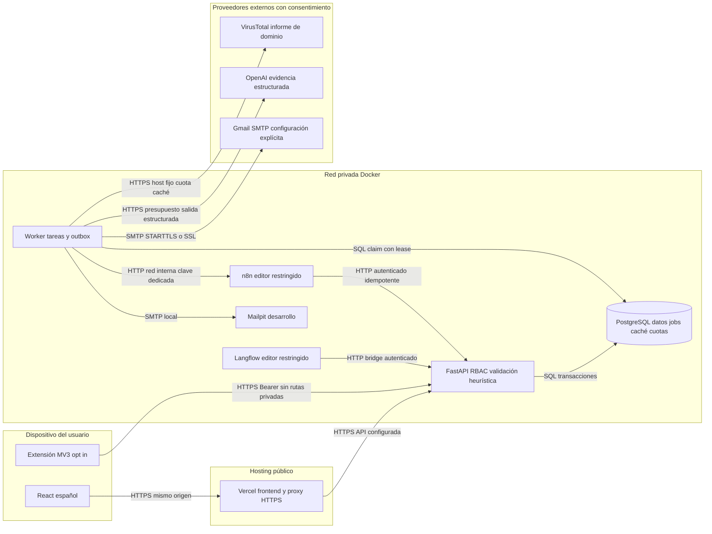
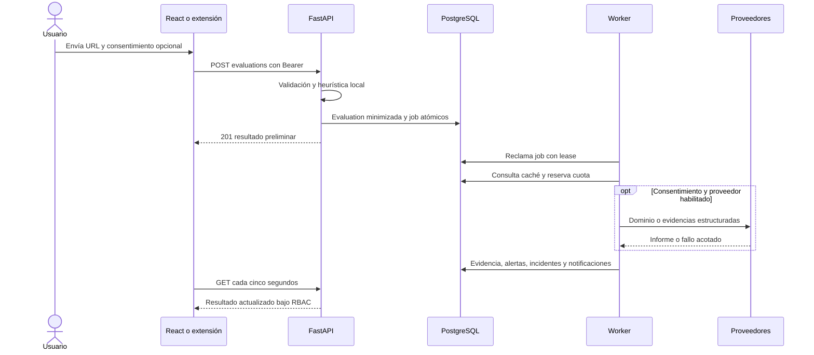
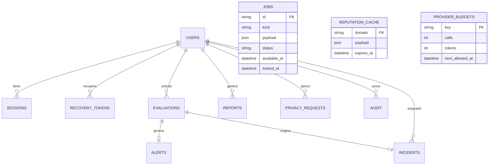

# Primera entrega de ingeniería de Vigía Financiera

Fecha de diseño: 20 de octubre de 2026. Proyecto académico para 10–20 usuarios. Este documento define alcance, arquitectura y aceptación; el estado verificado se registra separadamente en `QUALITY.md`.

## 1 Resumen ejecutivo

Plataforma web para evaluar indicadores de phishing financiero, explicar riesgo y gestionar alertas e incidentes. Foco inicial: BCP, Interbank y BBVA del Perú. React presenta una consola SOC en español, FastAPI valida y clasifica, PostgreSQL conserva evidencia minimizada. Una extensión Chromium MV3 ofrece evaluación manual y automática opcional. VirusTotal y OpenAI son enriquecimientos externos consentidos y asíncronos. LangChain organiza cuatro etapas; Langflow permite reproducirlas visualmente; n8n procesa eventos y reportes. El sistema comunica riesgo y falta de evidencia, nunca garantiza seguridad.

## 2 Supuestos y decisiones

| Decisión | Justificación |
|---|---|
| Monolito modular FastAPI | Contratos tipados, documentación OpenAPI y despliegue sencillo para un grupo académico |
| SQLAlchemy + Alembic + PostgreSQL | Persistencia real, claves foráneas, transacciones y migraciones reproducibles |
| Cola y caché en PostgreSQL | Jobs durables y presupuestos compartidos sin operar Redis innecesariamente |
| Worker independiente | No bloquea análisis local con proveedores, SMTP o documentos; recupera tareas tras caída |
| React + TypeScript + SWR | Navegación SPA, caché de consultas y refresco controlado; errores y estados vacíos explícitos |
| Polling cada 5 segundos | Alternativa cercana a tiempo real suficiente para 20 usuarios; no necesita infraestructura WebSocket |
| LangChain LCEL + Pydantic | Cuatro especialistas con salida estructurada y límites; sin ejecución arbitraria ni navegación |
| Langflow y n8n aislados | Herramientas visuales administrativas fuera del camino crítico y del acceso público |
| Argon2 + TOTP + JWT revocables | Bibliotecas mantenidas; sesión persistida verificada en cada petición, refresh rotativo HttpOnly |
| ReportLab, python-docx, openpyxl | Reportes editables e imprimibles sin fabricar formatos manualmente |
| Vercel frontend y API Docker HTTPS | El stack completo tiene procesos persistentes y servicios auxiliares; un frontend estático no sustituye Docker |

Las cuentas son creadas por un administrador. MFA es obligatorio para admin/analista y configurable por política para el usuario final. Se trabaja en una organización única: no se declara multi-tenancy implementado. Las consultas de usuarios finales están acotadas por propietario; analistas y administradores tienen alcance organizacional explícito. El rol se asigna de un catálogo fijo; roles y permisos arbitrarios quedan fuera del MVP.

## 3 Alcance y prioridades

| Área | P0 verificable | P1 verificable | P2 fuera del MVP |
|---|---|---|---|
| Acceso | Alta controlada, login, refresh/revocación, TOTP y recuperación | Preferencias y gestión de solicitudes ARCO | Federación empresarial |
| Detección | Normalización, heurísticas, scoring, reputación configurable | Caché y enriquecimiento progresivo con evidencia | Modelo entrenado propio, análisis de contenido |
| Captura | Manual/API y extensión MV3 | Texto de correo/SMS extraído en memoria | Lectura automática de buzones/SMS |
| Operación | Historial, alertas, incidentes | Asignación, observaciones, timeline, auditoría | SOC avanzado |
| IA | Fallback determinístico explícito | Cuatro agentes LangChain y flujo Langflow | Agentes autónomos con acciones administrativas |
| Notificación | Dashboard y extensión | SMTP, webhooks, n8n | Plataformas de mensajería adicionales |
| Reportes | PDF, DOCX, XLSX sobre registros autorizados | Consolidado y programación n8n | Analítica predictiva |
| Geografía | Estado sin evidencia geográfica | Gráficos alternativos | Mapa con geolocalización legítima verificada |

## 4 Arquitectura y límites de confianza



La URL analizada es entrada no confiable, no una instrucción. No se resuelve ni descarga su sitio. El único HTTP reputacional va a un host fijo de VirusTotal y no sigue redirecciones. Las APIs no aceptan callbacks arbitrarios. Webhooks y Langflow usan una clave de servicio distinta de contraseñas de usuario. Los editores de automatización solo deben ser accesibles por administradores; nunca publicar n8n o Langflow sin protegerlos. En local, los puertos publicados se vinculan a 127.0.0.1.



## 5 Matriz de funcionalidades y aceptación

| ID | Historia y criterio medible |
|---|---|
| AC01 | Como administrador creo cuentas; usuario normal recibe 403 al intentar hacerlo |
| AC02 | Como analista matriculo TOTP; una sesión de matrícula no accede a evaluaciones; códigos repetidos no se aceptan |
| AC03 | Como usuario evalúo URL; se devuelven score, nivel, indicadores, fuente, fecha, recomendaciones y versión |
| AC04 | Un usuario no obtiene historial, detalle ni reportes de otro usuario; IDs ajenos devuelven 404/403 |
| AC05 | Parámetros/fragmentos/rutas sensibles no aparecen en la evidencia persistida, exportada ni en logs de acceso |
| AC06 | URL privada, ambigua, con userinfo o esquema distinto de HTTP(S) recibe 422 y no produce tráfico al destino |
| AC07 | Un fallo/429/404 de reputación conserva el resultado local y explica insuficiencia de evidencia |
| AC08 | Riesgo alto crea alerta e incidente una sola vez por evaluación; analista puede asignar, observar y resolver |
| AC09 | Cada formato de reporte abre, contiene período, filtros, solicitante y datos reales; Excel no ejecuta texto como fórmula |
| AC10 | La extensión manual envía solo el origen, muestra score y evidencia; automático requiere activación explícita |
| AC11 | Repetir event_id de webhook no duplica su efecto; clave errónea no autoriza operaciones |
| AC12 | Cada agente produce salida tipada o estado unavailable; no modifica score ni visita sitios |
| AC13 | Exportación Langflow se reimporta y recorre sus nodos; se distingue ejecución sin modelo de ejecución OpenAI real |
| AC14 | JSON n8n se importa; workflows A–D son reproducibles con clave/SMTP configurados; se auditan resultados |
| AC15 | Latencia local p95 <500ms en fixture de laboratorio; mediciones externas y end to end se informan por separado |
| AC16 | Migración sobre PostgreSQL vacío aplica y esquema no presenta drift con ORM; job se recupera tras lease vencido |
| AC17 | Frontend compila y prueba un flujo login→MFA→evaluación→historial→incidente→reporte desde navegador |

## 6 Modelo de datos inicial



Los indicadores, fuentes y resultados estructurados se guardan como evidencia JSON versionada: conservan la forma evaluada sin crear relaciones de escaso valor para un grupo pequeño. Identidad, sesiones, evaluaciones, alertas, incidentes, reportes, auditoría y solicitudes sí tienen tablas y claves. La timeline es un documento de historial con actor/acción/fecha. Políticas singleton, recibos de webhooks y cuotas completan el esquema. Índices por propietario, fecha, riesgo, estado y disponibilidad de job apoyan las consultas. FK con cascada para eliminación/retención; auditoría de actor puede conservarse desidentificada con SET NULL. UTC en almacenamiento; zona IANA detectada desde navegador en primer acceso y editable en perfil. No se infiere ubicación por IP.

Para multi-tenancy futuro se debe añadir organization_id a todas las entidades y filtros y probar aislamiento antes de habilitar más de una organización; el MVP no mezcla organizaciones porque solo existe una.

## 7 Catálogo de API

Contrato de entradas y salidas: `CONTRACT.md`. Esquema autoritativo de la implementación: `/openapi.json` y `/api/docs`; copia exportada en `openapi.json`. Prefijo `/api/v1`, JSON tipado, 401 sin sesión, 403 rol insuficiente, 404 recurso ajeno/inexistente, 409 conflicto, 422 entrada inválida, 429 cuota.

| Categoría | Operaciones |
|---|---|
| Acceso | login, refresh, logout, me, password, recovery/request, recovery/complete, mfa/setup, mfa/confirm |
| Usuarios | GET/POST users, PATCH users/id, GET roles |
| Evaluación | POST/GET evaluations, extract, detalle y reanalyze |
| Gestión | dashboard, alerts + lectura, incidents + crear/asignar/cambiar estado/notas |
| Reportes | crear, listar, estado, descarga autorizada |
| Administración | integrations sin secretos, policies, audit |
| Privacidad | exportación propia, solicitudes ARCO y gestión autorizada |
| Servicio | webhooks/events, webhooks/notifications, automation/summary, automation/reports, automation/intelligence |

## 8 Agentes y automatizaciones

Cuatro especialistas LCEL: contexto determina faltantes; correlación relaciona evidencia local/reputación; explicación convierte hechos e inferencias en recomendaciones; gestión sugiere escalamiento sin ejecutarlo. Solo leen evidencia permitida. Salida Pydantic, cuatro llamadas máximas por análisis, tiempo/input/output acotados y presupuesto diario persistido antes de invocar. No se envían URLs originales ni texto de mensajes. El modelo se configura por OPENAI_MODEL; el nombre solicitado gpt-6-mini no fue confirmado en el catálogo consultado. Sin API key/activación/cupo, se informa unavailable sin simular una respuesta del modelo.

n8n: A recibe alerta y valida idempotencia antes de notificar; B aplica escalamiento de incidente; C programa reportes; D recibe eventos autenticados. Los JSON permanecen inactivos hasta importar credenciales de entorno y revisar destinatarios. No se envía correo real desde pruebas. Gmail depende del SMTP configurado en cada entorno; la conexión de Gmail al chat es independiente. Langflow tiene seis nodos y cinco conexiones que atraviesan el puente protegido de la API.

## 9 Directorios

```text
backend/app/          API, seguridad, modelos, motor, agentes, reportes y worker
backend/migrations/  revisiones Alembic explícitas
backend/tests/       pruebas unitarias, API, seguridad e integración
frontend/src/        React TypeScript, vistas, componentes y cliente API
extension/           Chromium Manifest V3 y pruebas de privacidad
automations/n8n/     cuatro JSON, importación y comprobaciones
automations/langflow/ exportación visual, generador y verificador
scripts/             configuración, datasets, operación y QA
docs/                diseño, contratos, manuales y evidencia
data/                fuentes/datos controlados, datos externos fuera de Git
infra/               configuración auxiliar de despliegue
.github/workflows/   CI con PostgreSQL y build frontend
compose.yaml         sistema reproducible local
vercel.json          frontend y proxy API HTTPS configurado
.env.example         catálogo de configuración sin secretos
.env                 configuración local privada, excluida de Git
```

## 10 Plan de implementación de cuatro semanas

| Semana | Fases y dependencia | Evidencia de salida |
|---|---|---|
| 1 | Fase 1 contratos/amenazas → fase 2 PostgreSQL, acceso, migraciones | OpenAPI, migraciones y pruebas RBAC/MFA |
| 2 | Fase 3 heurísticas, reputación, agentes | Pruebas adversarias, benchmark offline y degradación |
| 3 | Fase 4 interfaz/extensión → fase 5 integración visual y reportes | Flujo de navegador, exportaciones revisadas, flujos importados |
| 4 | Fase 6 seguridad, integración, rendimiento y manuales | Matriz de aceptación, limitaciones y procedimiento de despliegue |

Es una planificación académica de referencia, no una promesa de eficacia ni una afirmación de que transcurrieron cuatro semanas. Las fases se verifican por criterios y se marcan parciales si queda evidencia por obtener.

## 11 Riesgos y mitigaciones

Heurísticas sin entrenamiento no detectan todo phishing; el benchmark publica falsos negativos y no se usa ausencia de señales como legitimidad. Cuota pública VirusTotal impide analizar cada navegación en tiempo real: caché y límite conservador, sin colas infinitas de consultas. URL/componentes ambiguos se rechazan y ningún destino se descarga. Prompt injection no tiene herramientas para ejecutar acciones; se permite únicamente evidencia estructurada y recomendaciones no vinculantes. Los editores de n8n/Langflow tienen mayor privilegio que la app de usuario y requieren acceso restringido. Los proveedores son transferencias externas consentidas; ARCO, minimización y retención apoyan privacidad pero no constituyen certificación jurídica.

## 12 Requisitos no funcionales verificables

P95 heurística <500ms y caché <1s como metas de laboratorio, no SLA. 20 usuarios objetivo con polling acotado. Fallo de proveedores no invalida score local. Jobs con lease/reintentos y reporte de error no se declaran completados si fallan. Secretos en .env privado, MFA cifrado Fernet, contraseñas Argon2 y tokens refresh hasheados; access tokens en memoria web. Cookies seguras y HTTPS requeridos en producción. Retención configurable y backup/restore documentados. No se registra el cuerpo de entrada ni la URL cruda. Estados vacíos, mensajes españoles y navegación por teclado forman parte de la revisión de interfaz.
